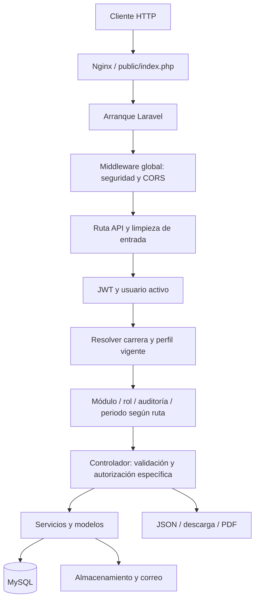
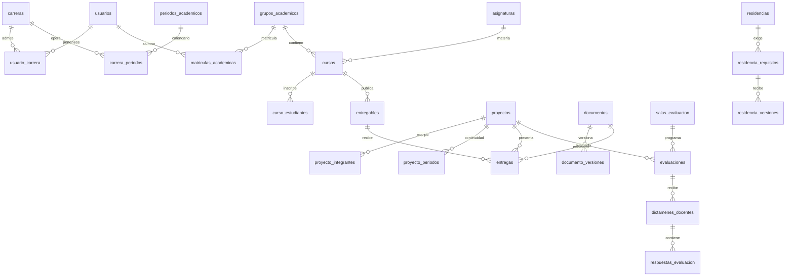
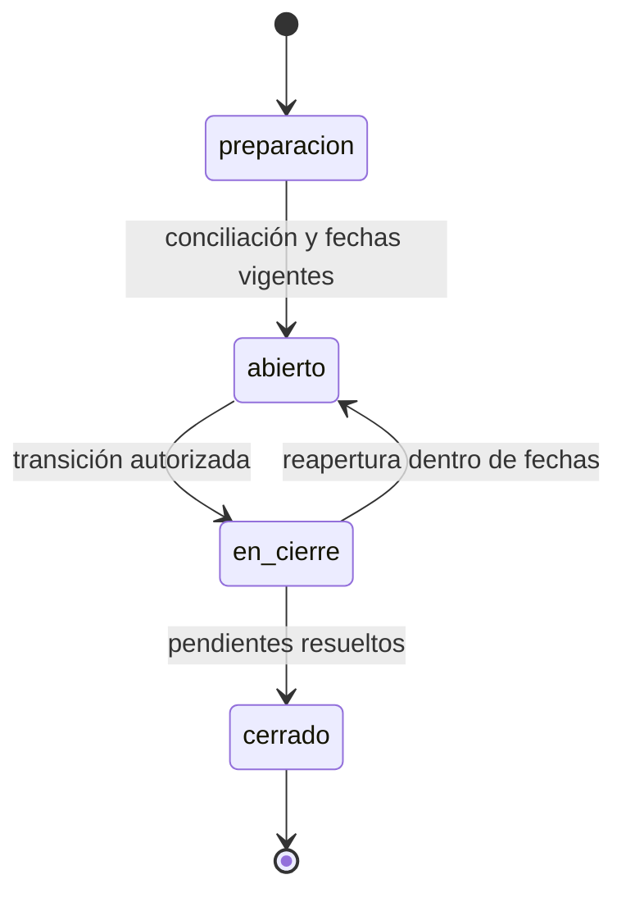

# Informe técnico y funcional de ApiSwgpi_v2

**Fecha de revisión:** 19 de octubre de 2026, referencia de fecha America/Mexico_City.  
**Proyecto:** `/home/natha/Sistema_web/ApiSwgpi_v2`.  
**Base del informe:** código presente en la copia de trabajo, registro real de rutas Laravel, configuración declarada, migraciones, SQL complementario y pruebas locales.

## Cómo consultar este informe

Este documento explica el sistema completo por procesos y componentes. Los anexos permiten bajar hasta las reglas y operaciones exactas de cada método:

| Documento | Contenido |
|---|---|
| [RUTAS.md](RUTAS.md) | Las 229 rutas registradas: verbo, URI completa, controlador, método y middleware; 223 son API. |
| [DATOS.md](DATOS.md) | Tablas declaradas, atributos, casts, alias, relaciones, 62 migraciones completas y 22 scripts SQL complementarios. |
| [CONFIGURACION.md](CONFIGURACION.md) | Variables de entorno, presencia sin valores secretos y todos los archivos de configuración con sus defaults. |
| [REFERENCIA.md](REFERENCIA.md) | Índice de 111 clases/traits propios y 839 métodos declarados, con declaraciones y código exacto de cada método. |
| [COMPONENTES.md](COMPONENTES.md) | Responsabilidad individual de los 30 controladores, 23 servicios y componentes de compatibilidad. |
| [PRUEBAS.md](PRUEBAS.md) | Resultados de las dos suites y catálogo de pruebas existentes. |
| [INVENTARIO.md](INVENTARIO.md) | 291 archivos propios inventariados, tamaños y huellas de fuentes de implementación. |
| [COMPLEMENTOS.md](COMPLEMENTOS.md) | Arranque, rutas, despliegue, scripts, vistas, assets y automatizaciones con su contenido de referencia. |
| [rutas.json](rutas.json) | Registro de rutas en formato procesable. |

Las fichas de los controladores incluyen las validaciones exactas, campos de entrada consultados, consultas, llamadas a servicios, respuestas y ramas de error. Los métodos privados también están incluidos: buena parte de las reglas se encuentra allí. La referencia conserva código para que el detalle no dependa de una paráfrasis incompleta.

**Alcance y límites:** se describe la implementación disponible, incluidas modificaciones locales preexistentes. No se certifica que todas las migraciones estén aplicadas en producción, que todas las tablas históricas sigan existiendo o que las integraciones externas estén operativas. No se copiaron secretos de `.env`, credenciales de prueba, datos personales, logs ni archivos subidos. No se auditó internamente el código completo de las dependencias de terceros; se documenta cómo las utiliza la aplicación. El informe no altera el funcionamiento de la API.

## 1. Qué es y para qué sirve

`ApiSwgpi_v2` es el backend de un sistema de gestión y seguimiento de proyectos académicos. Centraliza identidad, pertenencia a carreras, matrícula, propuestas, equipos, asesorías, actividades, evidencias documentales, evaluaciones y residencias. Añade funciones institucionales para configuración, auditoría, exportación, respaldos, integridad y continuidad operativa.

El dominio principal corresponde a semestres **5, 6, 7, 8 y 9**. Las salas de evaluación trabajan con etapas de **5 a 8**; las residencias individuales requieren matrícula en **9**. La aplicación mantiene resultados y antecedentes, y evita que cambiar un grupo, periodo o rúbrica reinterprete silenciosamente la evidencia histórica.

La API entrega principalmente JSON y archivos descargables. Los clientes web PHP y React están en proyectos hermanos; no son la interfaz interna de este backend. Las vistas de este proyecto corresponden a la bienvenida Laravel, correos y reportes PDF. Existen enlaces de notificaciones dirigidos a páginas del cliente PHP, por lo que parte del contrato de navegación depende de esos clientes.

No es un sistema de certificación escolar: una rúbrica, voto de aptitud o cierre de residencia registra seguimiento, pero no constituye por sí mismo aprobación de materias, titulación o egreso oficial.

### Capacidades principales

1. Acceso por identificador y contraseña con JWT, cambio de carrera y recuperación de contraseña por correo.
2. Siete perfiles institucionales y permisos efectivos según la carrera activa.
3. Administración de usuarios, membresías, datos personales e importaciones tabulares.
4. Catálogo de asignaturas, grupos, cursos, docentes y matrícula por periodo.
5. Autorregistro individual en materias de seguimiento, con clave y ventana de fechas.
6. Registro de proyectos/propuestas, integración de equipos, empresas y asesores.
7. Revisión de propuestas y ventanas de corrección.
8. Actividades por curso, entregas por proyecto, participantes individuales y versiones de archivos.
9. Evaluaciones por sala, jurados, rúbricas, turnos, temporizador, horarios y autorizaciones excepcionales.
10. Repositorio público/privado, hojas de liberación, presentaciones y documentos de tesis.
11. Expedientes individuales de residencia con requisitos, revisión por versión y cierre.
12. Tableros, notificaciones, avisos, indicadores y exportaciones.
13. Auditoría, comprobaciones de integridad multicarrera, respaldos y mediciones de continuidad.

## 2. Tecnología y dimensiones reales

| Elemento | Declaración o versión comprobada |
|---|---|
| PHP requerido | `^8.2`; plataforma Composer fijada en 8.2.0. |
| PHP usado en esta revisión | 8.5.11. |
| Framework | Laravel `^12.0`; `composer.lock`: **v12.69.2**. |
| Autenticación API | `tymon/jwt-auth` **2.3.0**, guard `api` con driver `jwt`. |
| Sanctum | **v4.3.3**, instalado; no es el guard utilizado por las rutas de negocio. |
| PDF | `barryvdh/laravel-dompdf` **v3.1.2**. |
| Correo alternativo | `resend/resend-laravel` **v1.4.0**, `resend/resend-php` **v1.13.0**; también transportes Laravel. |
| Persistencia principal | MySQL; algunas operaciones aceptan MariaDB. SQLite se usa en pruebas y configuración auxiliar. |
| Assets | Vite `^8.0.0`, Tailwind `^4.0.0`, `laravel-vite-plugin ^3.1`, scripts `dev` y `build`. |
| Pruebas | PHPUnit **11.5.56** instalado. |
| Producción declarada | Docker multietapa, PHP-FPM 8.2, Nginx, Supervisor, Railway. |
| Controladores API | 30, más controlador base. |
| Servicios de aplicación | 23. |
| Archivos en Models | 43: 37 archivos directos, 4 concerns y 2 pivots; `CareerSetting` es un helper, no un modelo Eloquent. |
| Middleware propios | 9. |
| Migraciones / SQL complementario | 62 / 22. |
| Rutas | 229 registros Laravel; 223 bajo `/api`. Un `GET|HEAD` se cuenta una sola vez. |

Estas versiones proceden de archivos locales, no de una consulta a registros externos. No se afirma que sean las versiones más recientes ni se realizó una auditoría actual de vulnerabilidades de dependencias.

## 3. Estructura del proyecto

```text
ApiSwgpi_v2/
├── app/
│   ├── Http/Controllers/API/    Endpoints y transformación de respuestas
│   ├── Http/Middleware/         Acceso, carrera, periodo, auditoría, CORS
│   ├── Models/                  Tablas y adaptación del esquema legado
│   │   ├── Concerns/            Alias y ámbitos por carrera
│   │   └── Pivots/              Relaciones proyecto-integrante y sala-proyecto
│   ├── Services/                Reglas académicas, archivos y operación
│   ├── Support/                 Contexto de carrera y utilidades de periodo
│   ├── Mail/                    Mensajes de recuperación y credenciales
│   └── Providers/               Registro de contexto y límites de solicitudes
├── bootstrap/                  Arranque, middleware y excepciones
├── config/                     Configuración de Laravel, JWT, archivos y continuidad
├── database/
│   ├── migrations/             Evolución de tablas y columnas
│   ├── sql/                    Parches manuales, multicarrera y vistas BI
│   ├── seeders/                Catálogos y datos de demostración
│   └── factories/              Generación de usuarios para pruebas
├── routes/
│   ├── api.php                 Rutas de negocio, prefijo /api
│   ├── web.php                 Página de bienvenida /
│   └── console.php             Comandos SGPI y tareas programadas
├── resources/views/
│   ├── emails/                 HTML y texto de correo
│   └── reports/                PDF de evaluación, sala y continuidad
├── public/                     Entrada HTTP y archivos públicos
├── storage/                    Documentos, temporales, caché y logs
├── tests/{Unit,Feature,Integration,Fixtures}/
├── scripts/                    Pruebas MySQL y ensayo académico
├── docker/                     Nginx y Supervisor
├── docs/                       Documentación funcional y operativa
├── .github/workflows/          Automatizaciones del repositorio
├── artisan                     Entrada de consola Laravel
├── composer.json / composer.lock
├── package.json / vite.config.js
├── Dockerfile / railway.json
└── .env / .env.example          Configuración local y plantilla
```

No hay una capa separada propia de `FormRequest` o `Policies` para este dominio. La validación y autorización están repartidas entre rutas, middleware, controladores, modelos y servicios. Para entender un permiso no basta con leer `routes/api.php`.

## 4. Cómo se procesa una solicitud



El prefijo `/api` se aplica al cargar `routes/api.php` desde `bootstrap/app.php`. La ruta `/up` es de salud del framework. La raíz `/` devuelve la vista `welcome`. Las otras rutas auxiliares proceden de paquetes y almacenamiento; su inventario exacto está en el catálogo.

Las seis rutas auxiliares registradas son `GET|HEAD /`, `GET|HEAD /up`, `POST /resend/webhook`, `GET|HEAD /sanctum/csrf-cookie`, `GET|HEAD /storage/{path}` y `PUT /storage/{path}`. Las de almacenamiento son rutas del framework asociadas a su configuración de servicio, no un CRUD académico diseñado en los controladores propios. La presencia del webhook de Resend tampoco prueba que esté configurado o recibiendo eventos.

Las excepciones de autenticación se traducen a HTTP 401 con `error`. Para JWT expirado se usa “La sesion ha expirado.”. Las respuestas de excepción vuelven a pasar por la aplicación de CORS. No hay un único formato universal para errores de negocio: aparecen `error`, `message` y `errors`, además de excepciones HTTP generadas por `abort*`.

### Middleware propios y efectos

| Middleware | Comportamiento |
|---|---|
| `SecurityHeaders` | `nosniff`, `X-Frame-Options: DENY`, referrer `no-referrer`, políticas de permisos y CSP restrictiva; evita caché en autenticación o solicitudes con bearer. |
| `EnsureCorsHeaders` | Responde preflight OPTIONS con 204; permite orígenes configurados, refleja sólo headers permitidos y agrega CORS también a errores. |
| `SanitizeApiInput` | Limpia cadenas JSON y query: etiquetas HTML, NUL y caracteres de control; recorre arreglos. Excluye `password`, confirmación, `admin_password` y `archivo`. No aplica de la misma forma al cuerpo multipart. |
| `CheckRole` / `role` | Compara capacidades del perfil activo; la lista separada por comas permite cualquiera de los roles solicitados. |
| `EnsureUserIsActive` / `active` | Rechaza cuenta desactivada y controla inactividad con caché por hash del token. |
| `ResolveCareerContext` / `career` | Verifica carrera activa y membresía vigente; establece carrera y perfil en el contexto de solicitud. |
| `EnsureCareerModuleEnabled` / `career.module` | Asocia prefijos de ruta a módulos habilitados de la carrera. |
| `AuditCareerMutation` / `audit` | Registra mutaciones y resultado HTTP en `auditoria_carreras`; no guarda contraseñas ni cuerpo completo. |
| `EnsureAcademicPeriodOpen` / `academic.open` | Para rutas académicas reconocidas, serializa escritura y cierre usando transacciones/bloqueos; controla periodo conciliado, fechas e historial. |

`ResolveCareerContext` tiene prioridad antes del binding de modelos: busca impedir que un binding encuentre un registro de otra carrera antes de aplicar el ámbito.

Los módulos reconocidos por prefijo son `usuarios`, `entregables`, `evaluaciones`, `academico`, `repositorio`, `configuracion`, `reportes` y `proyectos`. `settings/current` está exceptuado. No todas las rutas pertenecen al grupo que ejecuta este middleware; el catálogo identifica las diferencias.

## 5. Autenticación, sesiones y recuperación

Fuente principal: [AuthController](controladores/AuthController.md), [User](referencia/app/Models/User.md) y [EnsureUserIsActive](referencia/app/Http/Middleware/EnsureUserIsActive.md).

### Inicio de sesión

`POST /api/auth/login` recibe `id`, `password`, opcionalmente `remember` y `carrera_id`. El login efectivo usa identificador de usuario, no correo. El identificador es una cadena; puede representar número de control o empleado.

El controlador busca al usuario, compara el hash, exige `activo` y resuelve una carrera disponible. Para administrador general puede elegir cualquier carrera activa; para los demás necesita una membresía activa en una carrera activa, preferentemente la principal si no se especifica otra.

Devuelve `access_token`, `token_type: bearer`, `remember` y `user`. El usuario del login contiene datos de nombre, correo, perfil global, perfil activo, capacidades, indicador de administrador general, carrera activa, carreras disponibles, semestre/grupo calculados, foto y registro inicial. También indica si puede gestionar evaluaciones.

El JWT incluye claims `remember`, `career_id` y `career_role`. Aun con esos claims, el middleware vuelve a comprobar la membresía vigente: cambiar o revocar la membresía afecta el acceso sin esperar necesariamente a que caduque el token.

### Operaciones de sesión

| Endpoint | Función |
|---|---|
| `GET /api/auth/me` | Devuelve identidad y contexto vigente. |
| `GET /api/auth/careers` | Lista carreras accesibles; no exige resolver previamente la carrera del token. |
| `POST /api/auth/switch-career` | Valida nueva carrera, emite JWT nuevo e intenta invalidar el anterior. |
| `POST /api/auth/refresh` | Intenta renovar token, verificar usuario activo y acceso de carrera. No lleva el grupo de autenticación normal, pero requiere token para operar. |
| `POST /api/auth/heartbeat` | Devuelve hora del servidor y pasa por actualización de actividad. |
| `POST /api/auth/logout` | Invalida el token mediante JWT blacklist. |

Defaults JWT: TTL 480 minutos, TTL absoluto configurado 480 y ventana de refresh 43.200 minutos. La configuración puede reemplazarlos. `remember` no cambia explícitamente el TTL en `issueToken`; principalmente modifica el control de inactividad.

La inactividad utiliza `SystemSetting.session_timeout_minutes`, cuyo default de modelo es 30 minutos. El middleware tiene además un fallback de 60 si no recibe valor. La clave de actividad usa SHA-1 del token, no guarda el bearer en claro. Si la caché falla, el middleware registra advertencia y deja continuar la petición. Un primer acceso sin marca anterior no se considera expirado por inactividad.

**Detalle relevante:** el cliente puede activar la excepción de “recordar” enviando `remember_session` o `X-SGPI-Remember: 1`, además del claim del JWT. Por ello, el timeout de inactividad no es una imposición exclusivamente controlada por el servidor. La expiración criptográfica del JWT sigue siendo independiente.

### Recuperación de contraseña

1. `request-token`: recibe `id` y `email`, exige coincidencia con cuenta activa y genera seis dígitos aleatorios.
2. Guarda el hash en `password_reset_tokens`, identificado por correo, con fecha de creación.
3. Envía correo mediante `PasswordResetTokenMail`.
4. `verify-token`: verifica identificador, correo, hash y antigüedad máxima de **15 minutos**.
5. `reset`: exige token y contraseña confirmada de 6 a 72 caracteres; cambia el hash, borra el token de recuperación y emite un JWT recordado.

El límite es 5 intentos/minuto para login y 3/minuto para las rutas de recuperación, por IP e identidad. La respuesta de solicitud informa si el identificador/correo no coincide; no es una respuesta genérica anti-enumeración. No se observa una invalidación global explícita de todos los JWT previos al cambiar la contraseña.

## 6. Perfiles y separación por carrera

La autorización se apoya en **perfil global**, **perfil activo por carrera**, **capacidades derivadas** y **relación con el recurso**.

| ID | Perfil | Capacidades concedidas por `CheckRole` |
|---:|---|---|
| 1 | Administrador | `admin`, `teacher`, `academic_manager`, `project_manager` |
| 2 | Docente | `teacher` |
| 3 | Estudiante | `student` |
| 4 | Administrador general | `general_admin`, `user_governance`, `admin`, `teacher`, `academic_manager`, `project_manager` |
| 5 | Jefatura | `career_head`, `admin`, `teacher`, `academic_manager`, `project_manager` |
| 6 | Asistencia de jefatura | `career_head_assistant`, `teacher`, `academic_manager`, `project_manager` |
| 7 | Coordinación de proyectos | `project_coordinator`, `teacher`, `project_manager` |

Tener una capacidad de docente no equivale a estar asignado como jurado a una sala. Tampoco `academic_manager` garantiza poder confirmar todas las operaciones: `AcademicWorkflowService::manager()` restringe decisiones sensibles a administrador general, perfil 1 o perfil 5. Asistencia puede efectuar tareas académicas, pero no todas las confirmaciones de jefatura.

`User::getPerfilIdAttribute()` adapta al administrador general autenticado como perfil 1 dentro del contexto para compatibilidad con comprobaciones antiguas; `globalProfileId()` conserva el valor real. Esta distinción explica por qué algunas ramas internas enumeran `[1,2,5,6,7]` sin mencionar 4.

### Aislamiento de datos

- `CareerContext` se registra con alcance de solicitud, no como estado global compartido permanente.
- `BelongsToCareer` agrega `carrera_id` al ámbito de consulta y al crear registros cuando hay contexto.
- `ScopedToCareerMembership` limita usuarios por membresía activa y proyecta su perfil en esa carrera.
- `forCareer()` y `inCareer()` permiten consultas explícitas controladas.
- Las operaciones institucionales utilizan algunas consultas sin ámbitos, bajo permisos generales.
- Un estudiante sólo puede tener una carrera activa según las comprobaciones de membresía.
- Un docente puede tener varias membresías y cargos distintos según carrera.

**Límite esencial:** sin contexto, estos scopes no filtran por carrera. No son una barrera autónoma para todas las rutas públicas ni para `DB::table()`. Las consultas directas deben aplicar su filtro explícitamente. El apartado de hallazgos analiza el caso del repositorio.

## 7. Modelo de datos y compatibilidad del esquema

El código usa nombres de clases mayoritariamente en inglés, pero tablas y columnas normalizadas en español. Por ejemplo:

| Nombre API/modelo | Persistencia |
|---|---|
| `User.email`, `password`, `apa`, `ama` | `usuarios.correo`, `contrasena`, `apellido_paterno`, `apellido_materno` |
| `Project.title`, `description`, `subject_group_id` | `proyectos.titulo`, `descripcion`, `grupo_id` |
| `RepositoryDocument.visibility` | Traducción a la representación de visibilidad del esquema. |
| `DocumentVersion.file_path`, `version_number` | `documento_versiones.ruta_archivo`, `numero_version` |
| `EvaluationAttempt` | `dictamenes_docentes` |
| `EvaluationScore` | `respuestas_evaluacion` |
| `EvaluationRoom` | `salas_evaluacion` |

`HasLegacyAliases` adapta lectura/escritura de atributos. `LegacyAliasBuilder` adapta numerosas operaciones de consulta: select, where, whereIn, orderBy, groupBy, pluck, agregados y update. No es un traductor general de SQL arbitrario: las expresiones crudas y los joins necesitan revisar nombres reales.

Algunos campos son **virtuales**: semestre/grupo del usuario se obtienen de matrícula actual; semestre del proyecto puede obtenerse de `proyecto_periodos`; autores y archivo actual se obtienen mediante relaciones. No debe asumirse que cada propiedad JSON existe como columna física.

### Familias de tablas

| Familia | Objetos principales |
|---|---|
| Identidad | `usuarios`, `perfiles`, `usuarios_telefonos`, `password_reset_tokens` |
| Carreras | `carreras`, `usuario_carrera`, `carrera_modulos`, `configuraciones_carrera`, `registros_modulo_carrera`, `indicadores_carrera` |
| Académica | `periodos_academicos`, `carrera_periodos`, `grupos_academicos`, `asignaturas`, `cursos`, `curso_docentes`, `curso_estudiantes`, `matriculas_academicas` |
| Proyectos | `proyectos`, `empresas`, `proyecto_integrantes`, `proyecto_periodos` |
| Evidencias | `entregables`, `entregas`, `entrega_participantes`, `documentos`, `documento_versiones`, autores y etiquetas |
| Evaluación | `rubricas`, `criterios_rubrica`, `salas_evaluacion`, `sala_docentes`, `evaluaciones`, `dictamenes_docentes`, `respuestas_evaluacion`, liberaciones |
| Excepciones e historial | `autorizaciones_academicas`, `operaciones_academicas`, `movimientos_academicos`, `bitacora_academica` |
| Agenda | `salones_institucionales`, `recursos_agenda` |
| Residencia | `residencias`, `residencia_requisitos`, `residencia_versiones` |
| Comunicación | `notificaciones`, configuraciones de avisos, `avisos_academicos` |
| Operación | `auditoria_carreras`, `ejecuciones_integridad`, `respaldos_base_datos`, `verificaciones_restauracion`, `alertas_operativas`, `mediciones_continuidad`, `politica_continuidad`, `ejecuciones_academicas` |

Este mapa resume el esquema esperado por el código, no un `SHOW TABLES` de producción. [DATOS.md](DATOS.md) distingue tablas declaradas, objetos históricos y nuevas migraciones.



El diagrama representa relaciones funcionales principales; no pretende reproducir todas las claves foráneas físicas.

## 8. Usuarios, membresías y perfil personal

[UserController](controladores/UserController.md) administra identidad, filtros, importación y envío de credenciales. El grupo `user_governance` limita creación, edición, desactivación y acciones sensibles al administrador general. La consulta de listado también está disponible a perfiles de coordinación mediante otro grupo.

La creación exige ID alfanumérico con guion/guion bajo de máximo 10 caracteres, nombre, contraseña confirmada y perfil permitido. Permite correo único, apellidos, CURP, dirección y teléfonos. Las reglas de dirección exigen longitud mínima, caracteres permitidos y al menos un dígito. El perfil 4 no aparece como opción ordinaria de alta en estas validaciones.

La edición trata por separado identidad global, perfil de membresía y asignación académica. Las operaciones sensibles pueden exigir `admin_password`; sin ella, ciertas acciones responden 423 y `requires_password`. Se impide eliminar la propia cuenta administradora. Las rutas específicas de membresías consultan compromisos pendientes en cursos, salas, asesorías y residencias; las acciones de `UserController` no aplican uniformemente esa misma comprobación, como detalla H17.

La “eliminación” de usuarios/membresías se orienta a desactivar y conservar historial. No debe interpretarse cada respuesta “eliminado” como borrado físico. Los detalles dependen de la acción y están en sus fichas.

### Importaciones y plantillas

Hay plantillas públicas CSV/XLS y endpoints de importación de usuarios y proyectos. El parser propio lee formatos tabulares mediante CSV, HTML y estructura XLSX; no se usa una biblioteca general de Excel en `composer.json`. Una extensión `.xls` de plantilla puede contener tabla HTML compatible con Excel, no necesariamente formato binario XLS.

El límite de archivo de importación es 10 MB. La importación de usuarios prepara y valida filas antes de persistir el lote; contempla IDs ya existentes. La de proyectos procesa filas y acumula resumen/errores; no debe asumirse la misma atomicidad que la de usuarios. La inferencia de grupo de proyecto exige coherencia entre integrantes y carga académica existente.

El envío de credenciales limita solicitudes a 200 destinatarios, valida contraseña del administrador, aplica filtros y admite rotación de contraseña. Las plantillas admiten sustituciones de datos del usuario; una contraseña en hash no se recupera para enviarla. Los correos usan `Mail::send`, por lo que estas llamadas son síncronas salvo cambios en la implementación.

### Perfil propio

`GET /profile` obtiene los datos del usuario. `POST /profile` permite teléfonos, dirección, foto y cambio de contraseña con comprobación de la actual. `semestre` y `grupo` están prohibidos en esa edición ordinaria. La foto admite JPG/JPEG/PNG/WebP hasta 2 MB y se almacena en disco público.

`POST /profile/complete-initial` es para estudiante: solicita nombres, apellidos, semestre/grupo y foto opcional. Puede crear la primera matrícula a partir de un grupo vigente; si ya existe matrícula rechaza la reasignación con 409. La matrícula posterior se administra por operación académica, no desde los datos personales.

## 9. Carreras, módulos y catálogos

[CareerManagementController](controladores/CareerManagementController.md) lista carreras con conteos, perfiles, módulos y un indicador de preparación. Este indicador considera identidad visual, administración/jefatura, asignaturas, grupos, alumnos, cinco configuraciones y cuatro rúbricas; no es una prueba de aceptación integral.

Permite editar nombre, colores hexadecimales, lema, rutas de logo/portada, estado y módulos. Las membresías pueden asignarse, modificar perfil/principalidad o desactivarse. Una jefatura puede delegar perfiles operativos existentes mediante `AcademicOperationsController`, pero no modificar libremente cargos de administración/jefatura ni su propio perfil.

[CareerModuleController](controladores/CareerModuleController.md) maneja módulos, registros genéricos e indicadores. Un registro incluye módulo, clave, título, descripción, estado, responsable, fechas, datos JSON y activo. Los indicadores tienen valor actual, meta, unidad, color e icono. Son estructuras configurables; no prueban por sí mismas que exista un flujo específico para cada nombre de módulo.

La edición directa de módulo impide deshabilitar `evaluaciones` y `entregables`. La actualización institucional de carrera dispone de una vía distinta para escribir módulos; esta diferencia se documenta en hallazgos.

[CareerSetupController](controladores/CareerSetupController.md) importa catálogo JSON: hasta 500 asignaturas y 100 grupos. Normaliza claves, detecta duplicados y exige que las asignaturas de cada grupo estén en el lote. Usa formato de periodo `AAAA-1/AAAA-2` y conserva una regla heredada de semestres pares/impares que no coincide con toda la flexibilidad del flujo académico nuevo.

### Asignaturas y competencias

Las asignaturas tienen CRUD y clave única por carrera. La consulta pagina por defecto 15, con tope declarado 100. El borrado llama `delete()`; si hay relaciones restrictivas puede fallar según el esquema instalado.

**Las competencias no tienen un CRUD real independiente en la API actual.** `CompetenciaController` consulta `Asignatura` y produce una representación compatible con el cliente: ID de asignatura, fechas nulas y entregables vacíos. Crear, actualizar o eliminar competencia devuelve 422 explicando que se administra desde asignaturas. El modelo y migraciones históricos de `Competencia` siguen presentes, pero eso no significa que el endpoint los gestione.

### Grupos y cursos

Un grupo tiene carrera, periodo, semestre, clave y asignaturas. Asociar asignaturas produce cursos mediante la relación. La edición desactiva cursos retirados y conserva los existentes con `syncWithoutDetaching`.

Un grupo con matrícula, proyectos o inscripciones no puede cambiar semestre, clave o periodo: se crea un grupo destino. Eliminar un grupo con matrícula o proyectos está bloqueado. `syncStudents` asigna los alumnos enviados, pero **no es una sustitución destructiva de todos los integrantes**: no elimina implícitamente a los omitidos.

## 10. Ciclo académico, matrícula y promoción

Fuentes: [AcademicWorkflowService](servicios/AcademicWorkflowService.md), [AcademicPeriodLifecycleService](servicios/AcademicPeriodLifecycleService.md), [AcademicReconciliationService](servicios/AcademicReconciliationService.md), [AcademicPromotionService](servicios/AcademicPromotionService.md).

El calendario institucional está en `periodos_academicos`; el estado operativo se registra **por carrera** en `carrera_periodos`. No hay una sola bandera global suficiente para describir el estado de toda la institución.



Sólo puede haber un periodo abierto o en cierre por carrera. El cierre definitivo no tiene transición de regreso en el servicio. Para cerrar se revisan salas no finalizadas, residencias abiertas, solicitudes pendientes y entregas sin calificar. Las salas históricas sin periodo también pueden bloquear.

En `en_cierre`, el middleware permite un conjunto delimitado de acciones de revisión/finalización; no deja continuar altas y entregas ordinarias. Los GET no ejecutan activación ni promoción automática. Un esquema académico faltante puede producir 503; un estado inválido o conflicto histórico suele producir 409.

### Conciliación

La conciliación compara datos de grupos anteriores, cursos, campos heredados y matrícula consolidada. Produce candidatos, discrepancias, salas sin periodo/salón y excepciones heredadas, más un hash `snapshot`.

La aplicación de decisiones requiere permiso de jefatura/administración, estado de preparación y snapshot vigente. Debe resolver a cada estudiante exactamente una vez, justificar exclusiones y confirmar las salas históricas. No convierte automáticamente excepciones antiguas en aprobaciones amplias para todo un equipo. Registra continuidad de proyectos y marca el periodo como conciliado.

### Matrícula e inscripción no son lo mismo

`matriculas_academicas` contiene la adscripción principal de un alumno a un grupo para una carrera/periodo, con versión. `curso_estudiantes` indica qué materias cursa individualmente. `proyecto_integrantes` indica su equipo. Esas tres relaciones se usan para decisiones distintas: pertenecer a un equipo no inscribe a todas sus materias ni concede automáticamente acceso a toda evidencia.

### Promoción

La vista previa requiere un periodo destino posterior y muestra grupo sugerido, avance/permanencia, matrícula ya existente y pendientes. El avance máximo sugerido es noveno; desde noveno se propone permanencia.

La confirmación exige:

- `operation_id` UUID para identificar la operación.
- `snapshot` vigente de la vista previa.
- Una decisión por cada alumno, sin duplicados.
- Acción de avance, permanencia o salida y motivo explícito.
- Grupo destino compatible cuando no es salida.
- Ausencia de matrícula destino duplicada o movimiento ya confirmado.

Se ejecuta en una transacción con bloqueos y guarda la huella de la solicitud y su resultado. Repetir el mismo identificador con los mismos datos recupera el resultado; reutilizarlo con otros datos genera conflicto. No reescribe el grupo histórico del proyecto ni elimina la matrícula de origen. Los pendientes informan la revisión; no debe inferirse que todos sean automáticamente bloqueantes de la confirmación sólo porque aparezcan en la vista previa.

## 11. Autorregistro a materias

[CourseEnrollmentController](controladores/CourseEnrollmentController.md) y [CourseAdmissionService](servicios/CourseAdmissionService.md) comparten política de admisión.

Para inscribirse, el alumno debe estar activo, pertenecer a la carrera, tener matrícula en el periodo, elegir curso/grupo activos de seguimiento y estar dentro de la ventana de inscripción. Si el semestre del curso difiere del de matrícula, necesita autorización académica vigente para ese alumno y curso. La política no exige igualdad de grupo como condición independiente; sí compara semestre.

`POST /course-enrollments/{course}` recibe `password`, compara el hash de la clave de autorregistro, bloquea el curso y revalida antes de escribir. Tiene throttle de 10 solicitudes/minuto. La inscripción activa ya existente es idempotente.

El docente asignado o gestión académica puede habilitar acceso, configurar fechas y renovar clave. Cerrar autorregistro elimina la clave y cierra admisión, pero conserva el curso de seguimiento y las inscripciones anteriores.

La baja conserva la fila como inactiva y exige motivo. El alumno no puede darse de baja libremente si ya participó en una entrega o la envió; requiere intervención académica. La baja de estudiante también pasa por admisión, por lo que puede verse limitada por la ventana temporal. Consultar alumnos de curso requiere gestión o asignación docente.

## 12. Proyectos, propuestas, empresas y asesores

Fuentes: [ProjectController](controladores/ProjectController.md), [ProposalWorkflowController](controladores/ProposalWorkflowController.md), [CompanyController](controladores/CompanyController.md).

Un proyecto reúne título, descripción, grupo de origen, modalidad, integrantes, empresa, asesorías y clasificación de propuesta/tesis. Su semestre vigente puede provenir de continuidad por periodo y no sólo del grupo original.

### Registro y equipo

La creación recibe `title`, `description` o `descripcion`, modalidad, información de empresa y, según quién crea, grupo/semestre/año e integrantes. Las modalidades admitidas son `dual`, `proyecto_integrador` y `caso_integrador`.

Para un estudiante se comprueba registro de propuestas habilitado, perfil inicial completo, matrícula, inscripción pertinente, grupo activo y ventana de registro. Se impide integrarlo a un proyecto incompatible con una pertenencia previa activa. El tamaño máximo se obtiene de configuración de carrera; el default funcional es 4.

Los integrantes deben ser estudiantes activos. Cuando el proyecto ya tiene evaluaciones o entregas, no se permite sustituir el equipo como si fuera el mismo historial. Cambiar el grupo original también se rechaza: la continuidad se registra mediante `academic-operations/project-period`.

Los listados aplican filtros por usuario/rol, tipo de registro, modalidad y búsqueda. `my-projects` es una consulta distinta del catálogo general. Ver un proyecto y modificarlo tienen restricciones diferentes, por lo que el cliente debe respetar la respuesta del servidor y no deducir permisos de la mera visibilidad.

### Empresas

Se puede vincular una empresa aprobada o solicitar su registro con nombre, RFC, giro, contacto, cargo y dirección. El RFC se valida con patrón y longitud. La revisión admite `aprobada` o `rechazada`, guarda comentario, revisor y fecha. Usuarios sin gestión de proyectos sólo listan aprobadas; gestión puede filtrar por estado. El catálogo devuelve hasta 50 resultados.

`Empresa` no declara el concern multicarrera: el catálogo se trata de manera distinta de los proyectos. Eso debe considerarse al diseñar expectativas de aislamiento.

### Asesorías

Roles admitidos: `primario`, `secundario`, `asesor`, `revisor_1`, `revisor_2`. Los roles del comité de tesis requieren proyecto marcado como tesis. Se valida docente/membresía y unicidad de asignaciones según rol. No se puede retirar o sustituir un asesor con una residencia abierta vinculada sin reasignar antes el expediente.

Las operaciones de sincronización de asesores/asignaturas son distintas. No todas las capacidades de coordinación bastan para cada acción: existen validaciones internas adicionales.

### Revisión de propuestas

La revisión admite `aprobado`, `requiere_cambios` o `rechazado`; acepta comentario y exige fecha futura límite si se solicitan cambios. El docente debe tener el ámbito correspondiente, salvo gestión con permisos mayores. El estudiante sólo edita su propuesta cuando está habilitada la ventana de corrección.

Las ventanas se gestionan por grupo con inicio/fin. Las asignaciones docentes se vinculan a cursos y se desactivan preservando historial. Las rutas antiguas `proposal/exceptions` siguen registradas, pero responden 409 e indican usar las autorizaciones académicas actuales.

## 13. Actividades, entregas y calificación

Fuentes: [DeliverableController](controladores/DeliverableController.md), [DeliverySubmissionService](servicios/DeliverySubmissionService.md), [StoredFileService](servicios/StoredFileService.md).

La distinción central es:

- **Entregable:** actividad que se publica para un curso.
- **Entrega:** respuesta de un proyecto a esa actividad.
- **Documento:** identidad de la evidencia.
- **Versión:** archivo concreto de una entrega o reentrega.
- **Participante:** alumno del equipo que estaba inscrito en la materia correspondiente.

El controlador ofrece catálogo, entregables propios, matriz docente y documentos de evaluación. Permite creación, edición, desactivación, carga, descarga y calificación. `competencia_id` se acepta en algunas validaciones como compatibilidad y apunta a asignaturas; no debe interpretarse como una nueva relación autónoma con competencias.

La creación/edición resuelve el curso a partir de materia y contexto. Una actividad con entregas no puede cambiar de curso. Los estados que se normalizan incluyen borrador/publicado/cerrado. La autorización se comprueba dentro del controlador, además del grupo de rutas.

### Flujo de carga

1. Recibe `project_id` y multipart `archivo`.
2. Verifica carrera, actividad/proyecto activos y relación académica vigente.
3. Si carga un estudiante, exige pertenencia al proyecto e inscripción individual al curso.
4. Valida nombre, extensión, contenido MIME, tamaño y estructura de Office/EPUB cuando corresponde.
5. Crea temporal privado, calcula SHA-256 y promueve a ruta inmutable con ULID.
6. Dentro de transacción bloquea actividad/curso, entrega y documento según corresponda.
7. Crea documento privado y entrega si no existían; si existían registra reentrega y limpia calificación/comentario docente.
8. Registra participantes inscritos del equipo en `entrega_participantes`.
9. Asigna siguiente número de versión y guarda metadatos de archivo, disco, tamaño, MIME, autor y checksum si el esquema los soporta.
10. Reintenta hasta tres veces ante colisión identificada de número de versión; elimina el archivo preparado/promovido al fallar la operación controlada.

La calificación de la entrega es numérica de 0 a 100, por proyecto. No es la misma escala que la rúbrica de evaluación de sala. Las descargas resuelven entrega y acceso específico; si hay ambigüedad pueden requerir `project_id`. La política moderna permite inscripción activa o participación histórica explícita según la ruta y comprobación correspondiente.

Hay transacciones de base de datos y limpieza de archivos, pero no existe una transacción distribuida entre MySQL y filesystem. Un error posterior a una persistencia interna dentro de otra transacción puede requerir revisión de archivos residuales; no debe afirmarse atomicidad absoluta ante cualquier interrupción del proceso.

## 14. Evaluaciones, salas, rúbricas y turnos

[EvaluationController](controladores/EvaluationController.md) es el componente más extenso: 2.649 líneas en el corte revisado. Gestiona criterios, salas, agenda, jurados, turnos, resultados, archivo y PDF. [EvaluationAgendaService](servicios/EvaluationAgendaService.md) concentra validaciones de agenda y etapa.

### Rúbricas y escalas

Hay rúbricas de semestres 5–8, criterios globales o específicos de proyecto y orden de preguntas. Las evaluaciones nuevas guardan `criterios_snapshot` y `modo_puntaje` para conservar el instrumento aplicado. Un criterio con respuestas históricas no se edita/elimina libremente.

| Nivel recibido | Modo `levels` | Modo `numeric` |
|---|---:|---:|
| `totalmente_en_desacuerdo` | 0 | 1 |
| `en_desacuerdo` | 1 | 2 |
| `neutral` | 2 | 3 |
| `de_acuerdo` | 3 | 4 |
| `totalmente_de_acuerdo` | 4 | 5 |

El modo numeric sigue recibiendo las claves textuales anteriores y las transforma; no significa aceptar cualquier número libre. Para presentar porcentajes divide puntaje por máximo y multiplica por 100; posteriormente promedia respuestas normalizadas.

También hay compatibilidad con escala histórica `nada=0`, `poco=1`, `bastante=2`, `mucho=3`. En esquema antiguo la conversión agrupa neutral y desacuerdo como `poco`; es una pérdida de distinción que debe conocerse al interpretar resultados históricos.

### Creación y agenda de sala

Una sala identifica nombre, salón institucional, periodo, semestre/rúbrica, inicio/fin, docentes, responsable, proyectos, orden, minutos de exposición y evaluación, y máximo de intentos. Los tiempos deben alcanzar para todos los proyectos: cantidad × (exposición + evaluación).

Se bloquean recursos ordenados en `recursos_agenda` por salón, docente y proyecto. Se rechazan cruces de salón/docentes incluso entre carreras. Dos reservas consecutivas pueden ser válidas porque el conflicto utiliza desigualdad estricta en sus límites.

Los docentes deben tener membresía activa y perfil admitido en la carrera. Un proyecto de otra etapa necesita autorización vigente y ligada a la etapa destino. Un proyecto no puede tener simultáneamente otra sala activa según las comprobaciones. Una evaluación previa de la misma etapa requiere nuevo reintento autorizado.

No se permite guardar una evaluación sin criterios activos. Si falla la creación se revierte la sala y sus asignaciones en la transacción. Una sala con evaluaciones no puede cambiar la etapa/rúbrica ni periodo de forma que reetiquete el historial. Reprogramar horario tiene una operación específica y autorizaciones.

### Turnos y temporizador

El responsable bloquea la secuencia y habilita el proyecto actual. Las acciones de avanzar turno y controlar temporizador requieren `expected_sequence_version` para detectar una pantalla desactualizada.

Temporizador: `start`, `pause`, `resume`, `reset`, `finish`; duración explícita entre 60 y 14.400 segundos. No hay un proceso por segundo evaluando: se almacenan marcas de tiempo/estado y se calcula el tiempo restante al consultar.

Avanzar recibe `continue_next`; puede existir avance forzado con motivo de 10–500 caracteres y permisos superiores. Se comprueban resultados del turno, versión, estado y responsables dentro de transacciones. Una evaluación completada no se reutiliza como un intento nuevo.

### Guardar calificación de rúbrica

Requisitos: usuario con perfil admitido, asignación como jurado, hoja de liberación y todos los estudiantes liberados, ventana horaria abierta, turno habilitado y evaluación no finalizada. Se deben responder exactamente todos los criterios activos/snapshot, sin duplicados.

La ventana admite estado `scheduled`, `open`, `late_authorized` o `closed`, según fechas y extensión autorizada. Antes de persistir vuelve a comprobar horario y turno bajo bloqueo. Cada docente tiene un `dictamen` y respuestas por criterio.

Aunque la API conserva campos como `confirm_update` y `max_attempts`, **no sobrescribe un resultado ya existente**: si el dictamen tiene respuestas devuelve error e indica pedir un nuevo intento en otra evaluación. El historial prevalece sobre la apariencia de esos campos heredados.

En octavo se admite voto `apto_titulacion`. El resultado usa mayoría estricta de los votos disponibles: `floor(total/2)+1`. El resumen puede ser provisional mientras no estén todos los votos; no implica egreso oficial.

### Archivo, retroalimentación y PDF

La retroalimentación de sala corresponde al responsable o gestor. Archivar preserva historial y puede estar bloqueado durante secuencia activa. Reabrir/desarchivar evaluaciones y salas devuelve actualmente 409 para exigir nuevo intento. Las rutas genéricas de creación/edición de evaluación también redirigen funcionalmente hacia la gestión desde sala mediante 409.

Los PDF de evaluación y sala se generan con Dompdf, con matrices, promedios, comentarios y posibilidad de anonimizar nombres docentes. Hay código que construye gráficas mediante URL de QuickChart; esto introduce dependencia de red y potencial salida de etiquetas/puntajes al servicio externo al renderizar. No se probó esa integración externa en esta revisión.

## 15. Autorizaciones excepcionales

[AcademicAuthorizationService](servicios/AcademicAuthorizationService.md) contempla presentación de otra etapa, reprogramación, reintento e inscripción a semestre distinto.

La autorización identifica carrera, periodo, proyecto y/o alumno/curso/evaluación según tipo. Guarda motivo, solicitante, vencimiento, estado, versión, resolución, revisor y momento de consumo. La solicitud no equivale a aprobación.

El solicitante debe tener relación suficiente con el proyecto o capacidad de gestión. Las decisiones requieren autoridad, versión vigente y transición permitida. Una solicitud puede aprobarse o rechazarse; una aprobada puede revocarse mientras no esté consumida. Se verifica vigencia y alcance explícito. El mantenimiento convierte en vencidas las solicitudes/aprobaciones no consumidas que superan su fecha.

Las autorizaciones para etapa y reintento se vinculan a evaluaciones; no se concede a todo un proyecto una libertad indefinida para repetir cualquier evaluación. El detalle exacto depende del tipo y está conservado en las fichas de servicio/controlador.

## 16. Repositorio documental, liberaciones y tesis

[RepositoryController](controladores/RepositoryController.md) ofrece búsqueda pública, consulta por proyecto/etiqueta, detalle, descarga y vista inline; además tiene acciones autenticadas para listados privados, carga, revisión y publicación.

El listado público requiere documento activo, visibilidad pública y fecha de publicación. Pagina 12 resultados; permite `buscar`, `categoria` y `ordenar` con reciente/antiguo/nombre ascendente/descendente. La búsqueda considera nombre, descripción y autores relacionados.

Las categorías distinguen repositorio general, entregables, documentos de desarrollo/evaluación, hoja de liberación, presentación, tesis y residencias heredadas. El modelo adapta categorías históricas y `categoria_detalle`.

El alumno sólo puede cargar documentación de su proyecto y normalmente queda privada. La administración puede publicar/despublicar, registrando actor y fecha. Editar/eliminar desde el CRUD general queda bloqueado cuando la categoría corresponde a evidencia académica que debe gestionarse desde su propio flujo.

### Liberaciones y presentaciones

El estudiante carga `document_type: release_sheet` o `presentation`, ligado a proyecto. La hoja permite registrar liberación por cada integrante y revisor. La evaluación comprueba hoja y liberación de todos los estudiantes; la existencia de presentación también se informa, pero el control principal de calificación mostrado en `score()` se basa en `all_students_released`.

El listado privado y la revisión tienen controles específicos de profesor/proyecto. Sin embargo, las rutas públicas de detalle/descarga aplican una autorización interna diferente y más amplia; esa diferencia es un hallazgo importante, no una garantía de aislamiento equivalente.

### Tesis y residencia heredada

El flujo de carga de tesis exige estudiante de noveno. `storeThesisDocument` rechaza `tipo=residencias` con 409 para dirigir al expediente individual moderno. Los documentos históricos de residencia siguen consultables. El comité de tesis del proyecto y los documentos de tesis son funciones relacionadas, pero no sustituyen el expediente de residencia.

## 17. Almacenamiento y seguridad de archivos

Los discos son `local`, `public`, `swgpi_private`, `swgpi_public`, `legacy_public` y configuración genérica S3. La presencia de configuración S3 no acredita que las cargas de esta aplicación usen S3: los servicios eligen explícitamente discos locales según `uploads`.

Defaults de cargas:

- `SWGPI_PRIVATE_UPLOADS=false`: la escritura ordinaria usa `legacy_public` si no se habilita modo privado.
- `SWGPI_LEGACY_PUBLIC_FALLBACK=true`: puede buscar un archivo faltante en almacenamiento público legado.
- `SWGPI_X_ACCEL_DOWNLOADS=false`: sin aceleración Nginx por defecto.
- Máximo de servicio 50 MB, aunque algunas acciones consultan el ajuste de sistema.
- Residencias fuerzan disco privado aunque la bandera general no esté activa.

`StoredFileService` rechaza archivos vacíos, extensión no permitida, extensión ejecutable y doble extensión peligrosa. Valida MIME con `finfo`; Office OOXML debe contener carpetas esperadas dentro del ZIP y EPUB su marcador. Nombres se limpian, los archivos se renombran con ULID y se calcula SHA-256. Estos controles no equivalen a antivirus ni a análisis completo del contenido de un ZIP.

Las extensiones generales incluyen PDF, Office, ZIP, TXT, imágenes, EPUB, RAR y 7z. El repositorio tiene su propia lista más acotada; configurar un tipo en el sistema no necesariamente lo habilita en todos los endpoints. Residencias sólo aceptan PDF/DOC/DOCX hasta 50 MB.

`ProtectedDownloadService` valida ruta relativa, elimina traversals, resuelve disco y genera Content-Disposition seguro; emite `private, no-store`. Si se activa X-Accel requiere una ubicación interna de Nginx. La configuración Nginx incluida no define `/_swgpi_private`, así que esa opción necesita infraestructura adicional antes de usarse.

Nginx/PHP del Docker limitan uploads a 100 MB; el ajuste API permite hasta 200 MB. El límite efectivo es el menor entre cliente/proxy/Nginx/PHP/aplicación, y un archivo próximo a 100 MB puede exceder `post_max_size` por el sobre de multipart.

## 18. Residencias individuales

[ResidencyController](controladores/ResidencyController.md) opera principalmente con query builder, sin modelo Eloquent dedicado. El expediente se limita por carrera y por estudiante/asesor salvo gestión autorizada.

La creación exige estudiante, periodo, proyecto, empresa, asesor, origen y cambios propuestos de 20–5.000 caracteres. Verifica matrícula de noveno, pertenencia del alumno al proyecto, asesor asignado y coincidencia de empresa. Para origen `empresa`, el proyecto debe estar registrado en noveno del periodo; para `continuacion`, debe ser proyecto integrador.

Existe unicidad por estudiante/periodo. Se crean tres requisitos obligatorios: **Plan de trabajo, Avance documental e Informe final**. Asesor/gestión pueden agregar requisitos y plazo.

Sólo el residente sube archivos. Cada carga crea versión, preserva checksum y aumenta la versión del expediente. No se aceptan entregas fuera del plazo. Sólo el asesor asignado revisa una versión pendiente como `correcciones` o `validada`, con observaciones. Una revisión ya registrada no se sobrescribe.

Reasignar asesor y cerrar exigen autoridad de gestión final y versión vigente. Para cerrar, la última versión de cada requisito obligatorio debe estar validada. La respuesta declara expresamente que el cierre no representa egreso oficial. Las descargas verifican acceso al expediente y pertenecía de la versión al requisito.

## 19. Tableros, notificaciones y configuración funcional

### Tableros

`DashboardController` devuelve estadísticas, series para gráficas y proyectos recientes. El tablero general filtra carrera y se cachea 20 segundos. Los de docente/alumno seleccionan proyectos relacionados. Calcula usuarios por perfil, proyectos/propuestas y estados de entregables.

El “porcentaje de cumplimiento” se calcula desde entregables cerrados sobre total de actividades consideradas; no es automáticamente promedio de calificaciones ni porcentaje individual de materias aprobadas. Los tableros de docente/alumno contienen una discrepancia de clave de estado descrita en hallazgos.

### Notificaciones

`ActivityNotificationService` deduplica destinatarios, excluye al actor y registra mensajes internos; no es un sistema push/WebSocket. El controlador lista hasta 50, cuenta no leídas y permite marcar una o todas, verificando propietario.

La implementación tiene una comprobación de existencia de tabla antigua `notificaciones_actividad` mientras el modelo apunta a `notificaciones`. Si sólo existe la tabla normalizada, algunas operaciones se saltan. El mantenimiento académico escribe directamente en `notificaciones`, por lo que no utiliza exactamente la misma ruta de creación.

### Ajustes y avisos

`SystemSetting` mezcla defaults con valores persistidos y soporta representación JSON o columnas tipadas. Cachea 60 segundos más memoización estática dentro del proceso. `CareerSetting` almacena cinco ajustes por carrera: avisos, habilitación de propuestas, máximo de integrantes, gestores de evaluación y modos de rúbrica.

El controlador ofrece ajuste público, actual autenticado, administración y avisos. Los valores públicos incluyen apariencia, timeout, límites de archivos y calendario; sin contexto de carrera no selecciona periodo operativo actual. Los avisos tienen título, mensaje, audiencia, tipo, duración y fechas; se filtran por vigencia. La audiencia forma parte del contrato que también deben interpretar los clientes.

La actualización admite timeout 1–480, tamaño 1–200 MB, integrantes 1–10, escala tipográfica 85–125 y temas light/dark/system. Algunas claves son globales aunque se editen dentro de una carrera; no todos los ajustes quedan aislados por carrera.

## 20. Auditoría, exportación y Power BI

La auditoría HTTP registra carrera, actor, método, ruta, acción, estado HTTP, IP, agente de usuario y parámetros de ruta/nombres de query. Excluye heartbeat/logout. Un fallo al escribir auditoría se reporta pero no necesariamente bloquea la operación principal.

La bitácora académica es distinta: conserva acción, entidad e instantáneas antes/después para conciliación, matrícula, promoción, autorizaciones, residencia y otros cambios. No todas las rutas tienen ambas auditorías.

Exportación de carrera: ZIP con `usuarios.csv`, `asignaturas.csv`, `grupos.csv`, `proyectos.csv`, `indicadores.csv`, `modulos.csv`, `rubricas.csv` y `LEEME.txt`. No incluye contraseñas, tokens ni documentos privados. No es un respaldo completo restaurable. El administrador general dispone de CSV institucional de conteos.

La capa analítica está declarada en SQL con **21 vistas** `bi_*`: 9 dimensiones, 10 vistas de hechos y 2 vistas de control/relaciones. Incluye carrera, perfil, usuario, periodo, grupo, asignatura, empresa, proyecto, sala, membresía, inscripción, cursos, integrantes, evaluaciones, dictámenes, respuestas, documentos, entregables y entregas.

Los hechos de evaluación tienen distinto grano: evaluación, docente/evaluación y respuesta/criterio. Unirlos indiscriminadamente duplica conteos. La documentación propone relaciones 1:N y filtro en una dirección, usuario de sólo lectura y control de calidad. Las vistas no son un conector HTTP automático ni una integración ya desplegada de Power BI. Su instalación y adaptación al flujo académico consolidado deben contrastarse con el esquema real.

## 21. Respaldos, integridad y continuidad

[MulticareerIntegrityService](servicios/MulticareerIntegrityService.md) ejecuta 11 verificaciones: proyectos/grupos, cursos/grupos, cursos/asignaturas, evaluación/proyecto, evaluación/sala, documento/proyecto, rúbrica/proyecto, alumnos/grupos, integrantes/membresías, alumnos en varias carreras y configuraciones mínimas. Puede guardar historial. No verifica exhaustivamente todas las tablas nuevas de octubre.

[DatabaseBackupService](servicios/DatabaseBackupService.md) requiere MySQL/MariaDB. Ejecuta `mysqldump` con single-transaction, rutinas y triggers; usa contraseña por entorno del proceso y comprime a `.sql.gz`. Guarda tamaño y SHA-256 en base, con archivo privado y permisos restrictivos. Tiempo máximo del proceso: 300 segundos.

La verificación comprueba checksum, descomprime, crea una base temporal con nombre aleatorio **en el servidor configurado**, importa mediante `mysql`, verifica siete tablas esenciales y suma sus filas; después elimina esa base temporal. No es lo mismo que el servidor MySQL sin red utilizado por las pruebas. Necesita permisos de crear/eliminar bases en ese servidor y no es una validación exhaustiva de todas las relaciones ni de los archivos documentales.

La salud de respaldos detecta archivos faltantes/alterados, espacio y candidatos de retención. La política limita retención a 7–365 días, con default 30; conserva siete copias recientes y las copias vinculadas a las tres verificaciones correctas más recientes. La depuración aísla temporalmente el archivo antes de actualizar el registro.

`OperationalAlertService` genera alertas de integridad, almacenamiento, antigüedad de respaldo, falta de restauraciones verificadas, objetivo de continuidad y degradación. Estados: abierta, atendida y resuelta. Marcar atendida no significa que la condición causante desapareció. No se observa una integración de alarma externa obligatoria en este servicio.

`ContinuityReportService` calcula índice a partir de cuatro controles: integridad multicarrera, almacenamiento de copias, respaldo reciente y existencia de restauración verificada. Cada control aporta 25 puntos. No es una medición de disponibilidad real, RTO/RPO alcanzado ni una certificación integral. Guarda historial, tendencia y exporta PDF.

`ReleaseReadinessService` revisa entorno/debug, secretos presentes, conexión, tablas multicarrera, integridad, copias, restauración, directorio, espacio de al menos 1 GB, binarios y `composer audit`. Es un control parcial: no sustituye diagnóstico académico, piloto ni revisión de configuración de archivos. No se ejecutó contra la conexión real durante este informe.

## 22. Comandos y tareas programadas

Fuente completa: [routes/console.php](../../routes/console.php).

| Comando | Función / efecto |
|---|---|
| `inspire` | Mensaje de ejemplo Laravel. |
| `sgpi:check-multicareer {--store} {--source=consola}` | Consulta integridad; con `--store` escribe historial. |
| `sgpi:backup-database {--source=consola}` | Crea archivo y registro de respaldo. |
| `sgpi:verify-backup {backup?}` | Restaura copia en base temporal del servidor configurado y registra verificación. |
| `sgpi:backup-health` | Comprueba archivos/checksums y estado de retención. |
| `sgpi:scan-operations` | Actualiza alertas operativas. |
| `sgpi:measure-continuity {--source=consola}` | Guarda medición histórica. |
| `sgpi:release-check {--allow-local}` | Controles de preparación, incluida auditoría Composer. |
| `sgpi:diagnose-academic {--baseline}` | Diagnóstico de tablas/columnas, conteos y pendientes; sólo lectura. |
| `sgpi:prepare-academic-periods` | Prepara estados, vence autorizaciones, avisa cierre y registra ejecución. No activa ni promueve. |

| Tarea | Calendario declarado |
|---|---|
| Preparación académica | Cada hora, minuto 10; timezone explícita America/Mexico_City. |
| Integridad multicarrera | Diario 00:20. |
| Respaldo | Diario 01:00. |
| Salud de copias | Diario 01:30. |
| Medición de continuidad | Diario 02:15. |
| Alertas | Diario 02:30. |
| Verificación de respaldo | Domingo 02:00. |

Todas usan `withoutOverlapping`. Las tareas sin timezone explícita siguen la configuración de aplicación, cuyo default es America/Mexico_City. Un scheduler detenido implica que el calendario declarado no se ejecuta. El mantenimiento crea avisos próximos al cierre y estados en preparación; no toma decisiones humanas de promoción/apertura.

## 23. Instalación y despliegue declarados

El Docker usa dos etapas. En build instala extensiones PHP, Composer, Node 20 y dependencias, compila assets y prepara Laravel. En runtime usa PHP-FPM, Nginx y Supervisor. Extensiones declaradas incluyen GD, ZIP, PDO MySQL, mbstring, XML, bcmath y opcache.

El entrypoint crea directorios, ajusta permisos, adapta el puerto a `PORT`, crea el enlace público storage y genera cachés de configuración/rutas/vistas. **No ejecuta migraciones automáticamente al arrancar las réplicas web.** Inicia PHP-FPM, Nginx y Supervisor. El healthcheck solicita `/up`; esto no prueba por sí solo esquema académico, SMTP ni restauración de copias.

Supervisor inicia un worker `queue:work --sleep=3 --tries=3 --max-time=3600`. El scheduler `schedule:work` depende de `SGPI_SCHEDULER_ENABLED`, cuyo default Docker es false. La intención documentada es habilitarlo en una sola instancia designada.

`composer setup` sí contiene `migrate --force`, mientras que el procedimiento académico exige revisar la base normalizada y aplicar migraciones controladas. No conviene interpretar ese script genérico como procedimiento seguro de actualización de una instalación con historia.

Los scripts `rehearse-academic.sh/.php`, presentes como archivos locales no rastreados al iniciar esta revisión, exportan la conexión configurada, copian versiones documentales y migran una copia aislada. Son distintos de las pruebas sintéticas y no se ejecutaron. La copia de archivos recorre `DocumentVersion`; no debe asumirse que respalda automáticamente todos los archivos de residencias guardados en otra tabla.

### Configuración local observada, sin secretos

El `.env` local declara `APP_ENV=local`, `APP_DEBUG=true`, `DB_CONNECTION=mysql`, sesiones database, filesystem local, cola sync, caché file y mailer SMTP. Esto describe el archivo del workspace, no necesariamente Railway. No se transcriben host, base, usuarios, contraseñas, claves, tokens ni direcciones privadas.

Las variables de cargas privadas y scheduler pueden depender de defaults si no se declaran o de inyección externa. El anexo de configuración registra nombres/presencia sin sus valores. La configuración efectiva puede estar afectada por caché y variables del proceso.

## 24. Contrato HTTP y uso desde los clientes

Para JSON autenticado se usa `Authorization: Bearer <JWT>`, `Accept: application/json` y `Content-Type: application/json`. Las cargas usan multipart y el campo `archivo`; residencia usa `file` y perfil usa `photo`. No se debe enviar `Content-Type: application/json` al construir multipart con boundary.

Ejemplo conceptual de login, con datos ficticios:

```json
{
  "id": "ALUMNO01",
  "password": "<contraseña del usuario>",
  "remember": false,
  "carrera_id": 1
}
```

Ejemplo de respuesta abreviada, no exhaustiva:

```json
{
  "access_token": "<JWT>",
  "token_type": "bearer",
  "remember": false,
  "user": {
    "id": "ALUMNO01",
    "active_profile_id": 3,
    "capabilities": ["student"]
  }
}
```

| Código | Interpretación en esta aplicación |
|---:|---|
| 200 | Consulta o actualización correcta, también archivos. |
| 201 | Creación de registro/documento. |
| 204 | Preflight CORS. |
| 401 | Credenciales/token inválido, expiración o inactividad. |
| 403 | Cuenta, rol, carrera, asignación, pertenencia o permiso insuficiente. |
| 404 | Recurso inexistente o deliberadamente no visible. |
| 409 | Conflicto de periodo, historial, versión, operación o ruta heredada inhabilitada. |
| 422 | Validación de campos/reglas y algunos endpoints de compatibilidad. |
| 423 | Solicitud de contraseña administrativa en acciones sensibles. |
| 429 | Límite de solicitudes. |
| 500 | Error interno, almacenamiento, correo u operación no controlada. |
| 503 | Esquema requerido no instalado. |

Las respuestas paginadas Laravel incluyen `data` y metadatos; otros endpoints devuelven arreglo directo, objeto `data`, `message` con entidad o archivo binario. No hay un sobre JSON uniforme. No se encontró una especificación OpenAPI propia; el catálogo y las fichas son la referencia verificable para integrar cada acción.

Los clientes deben refrescar vistas ante 409 de snapshot/version y no repetir a ciegas una decisión con datos viejos. Para promociones, conservar el UUID de la operación distingue reintento idempotente de una operación nueva.

## 25. Pruebas ejecutadas y alcance de la evidencia

Se ejecutaron las pruebas existentes sin añadir pruebas ni modificar implementación:

| Suite | Pruebas | Aserciones | Resultado |
|---|---:|---:|---|
| Unit + Feature | 48 | 245 | Aprobadas |
| Integración MySQL aislada | 37 | 197 | Aprobadas |
| Total | **85** | **442** | **Aprobadas** |

La suite MySQL incluye flujos académicos, concurrencia en reservas, autorizaciones, promoción, conservación de historial, residencia, inscripción, descarga y regresiones recientes de autorregistro/rúbricas. El inventario de métodos de prueba está en [PRUEBAS.md](PRUEBAS.md).

No se ejecutó un recorrido completo en navegador ni una validación de todos los endpoints contra producción. No se enviaron correos reales ni se generó un respaldo real. No se ejecutó un build Docker o una auditoría Composer de vulnerabilidades. Pasar las suites no invalida hallazgos de rutas o ramas no cubiertas.

El CI declarado prueba PHP 8.3, 8.4 y 8.5 con Unit/Feature; la imagen usa PHP 8.2. La suite MySQL no forma parte del comando de CI actual. Esto deja una diferencia entre la matriz declarada de pruebas y el entorno runtime del contenedor.

## 26. Hallazgos y discrepancias que afectan la comprensión del sistema

Estos puntos distinguen hechos comprobados de riesgos inferidos por lectura. Se documentan sin aplicar correcciones.

### H01. Plantilla de correo interceptada por ruta dinámica — comprobado en enrutamiento local

En `routes/api.php`, `GET /users/{id}` está antes de `GET /users/credential-email-template`. Al pedir al router local que resuelva `/api/users/credential-email-template`, selecciona **`UserController@show`**. La existencia de la ruta nominal en `route:list` no garantiza alcanzarla. Falta validar además la colección compilada del despliegue si difiere.

### H02. Autorización demasiado amplia en descargas privadas de repositorio — evidencia estática de alta prioridad

Las rutas públicas `repositorio/{id}`, `download` y `view` no ejecutan `active` ni `career`. `canAccessDocument()` acepta cualquier docente autenticado y usuarios que pueden gestionar proyectos sin comprobar explícitamente carrera o asignación. Sin `CareerContext`, los scopes no aplican filtro de carrera. Esto abre una vía de acceso privado más amplia que los listados protegidos. Debe revisarse con pruebas de cuentas de distintas carreras y cuentas desactivadas; no se realizó explotación contra datos reales.

### H03. Nombre de tabla de notificaciones inconsistente — comprobado en código

Servicio/controlador preguntan por `notificaciones_actividad`, pero `ActivityNotification::$table` es `notificaciones`. Si la instalación sólo tiene la normalizada, `send/index/markAllRead` pueden no operar y devolver vacío/éxito sin trabajo. La existencia de una tabla o vista de compatibilidad en un servidor podría alterar ese resultado; no se consultó producción.

### H04. Privacidad lógica y física pueden diferir — comprobado en defaults

Los documentos se marcan privados, pero el default de escritura ordinaria es `legacy_public` y existe `public/storage`. Si se conoce la URL física y el servidor la sirve, puede no pasar por el controlador de descarga. Residencias sí fuerza disco privado. No se afirma que todos los archivos desplegados estén expuestos: depende del disco usado y configuración real.

### H05. Binarios operativos no declarados en la imagen runtime — evidencia del Dockerfile

El servicio de respaldos necesita `mysqldump` y `mysql`, pero el runtime mostrado no instala sus paquetes ni copia estos binarios. `ReleaseReadinessService` invoca `composer`, que se instala en build y no se copia explícitamente a runtime. Esas funciones pueden fallar en la imagen sin provisión adicional. No se ejecutó una construcción para confirmar la imagen final.

### H06. Restricción de módulos no uniforme — comprobado en código

`CareerModuleController::updateModule` impide desactivar evaluaciones/entregables, pero `CareerManagementController::update` acepta la lista `modules` y escribe directamente su estado. Además, las rutas privadas de evaluación/tesis dentro del primer grupo de repositorio no incluyen `career.module` ni `audit`. Son vías con políticas diferentes.

### H07. Pendientes de tablero usan clave inexistente — comprobado en código

La lista de estados de entregable del dashboard es borrador/publicado/cerrado. Los tableros docente y estudiante leen `['pendiente'] ?? 0`, por lo que ese indicador queda en cero en esa lógica. El tablero general usa publicado. Los conteos además se basan en grupos de proyectos y no necesariamente equivalen al seguimiento individual por inscripción de la consolidación nueva.

### H08. Rutas conservadas que no ejecutan la operación nominal — comprobado

Competencias devuelve 422 para mutación; excepciones antiguas de propuesta 409; creación/edición genérica de evaluación 409; desarchivo de evaluación/sala 409; residencia por el flujo antiguo de tesis 409. Un inventario CRUD sin leer controladores describiría capacidades inexistentes.

### H09. Política académica heredada en importador — comprobado

`CareerSetupController` conserva `AAAA-1 -> [6,8]` y `AAAA-2 -> [5,7,9]`, mientras el servicio semestral nuevo admite 5–9 y calendario institucional. Importar catálogo y crear grupos por otras rutas puede tener restricciones diferentes.

### H10. Cobertura del middleware depende del texto de la URI — comprobado

`EnsureAcademicPeriodOpen` usa regex de prefijos. Incluye `academic-operations/project-periods`, pero la ruta real es `project-period` singular. El controlador sí exige periodo abierto, por lo que no equivale a ausencia total de control; falta la misma envoltura de serialización del middleware para esa coincidencia.

### H11. Encabezados para vista embebida contradictorios — evidencia de configuración

Nginx permite determinados `frame-ancestors`, mientras `SecurityHeaders` fija `DENY`, `frame-ancestors 'none'` y `sandbox`. La vista inline o documentos embebidos pueden quedar bloqueados por la política más restrictiva. `inline` en Content-Disposition no elimina esa política. No se probó en navegador.

### H12. Funciones de operación no certifican recuperación integral — comprobado por alcance

El respaldo del servicio es sólo base de datos; su verificación revisa siete tablas y conteos, no todos los documentos/versiones ni todas las relaciones. El índice de continuidad son cuatro controles, y la integridad multicarrera conserva consultas a estructuras antiguas como `grupo_estudiantes`. Las tablas académicas nuevas requieren sus propios diagnósticos y ensayos.

### H13. Diferencias de límites y defaults de configuración — comprobado

La API permite configurar 200 MB, pero Docker limita 100 MB. El repositorio usa lista de extensiones propia. Los ajustes del sistema y de carrera se combinan, pero algunas escrituras son globales. La bandera de recordar sesión también puede provenir de un header del cliente. Ninguna de esas opciones debe interpretarse sólo por la etiqueta del frontend.

### H14. CI y dependencias de build necesitan contraste de runtime — evidencia parcial

CI no ejecuta la suite MySQL y no incluye PHP 8.2 de la imagen. Docker instala Node 20 sin fijar revisión mientras package.json pide Vite 8; la compatibilidad concreta depende de versiones resueltas/engines. No se concluye fallo de build sin ejecutarlo.

### H15. Historial de migraciones no es receta única de reconstrucción — evidencia documental y de código

Conviven tablas antiguas en inglés, renombramientos, importaciones normalizadas en español y scripts SQL externos al migrador. La consolidación de octubre es aditiva y su `down()` rechaza una reversión destructiva. Ejecutar todos los scripts históricos o `migrate:fresh` no es un procedimiento inferible como seguro para la base actual.

### H16. Etiquetas consultan una relación no declarada — comprobado en código

`DocumentTagController::index` ejecuta `withCount(['deliverables', 'repositoryDocuments'])` y `show` carga `deliverables`, pero el modelo `DocumentTag` sólo declara `repositoryDocuments`. No se encontró declaración de `deliverables` en el modelo o sus traits propios. Esas consultas pueden producir error de relación/método, en vez del listado esperado. La mutación de etiquetas no necesariamente falla por la misma causa. Además, la validación de nombre único es global en `etiquetas`, mientras la consulta se delimita por carrera.

### H17. Gobierno de usuarios no aplica la misma liberación de compromisos que membresías — comprobado en código

`CareerManagementController` y `AcademicOperationsController` llaman a `AcademicMembershipService::ensureReleased` antes de cambios relevantes. En contraste, `UserController::update` modifica el perfil de membresía directamente; `destroy/toggleActive` cambian actividad y desactivan vínculos de grupos/cursos sin invocar ese servicio. Estas rutas están restringidas al administrador general, pero pueden dejar una política de conservación de compromisos distinta de la esperada en la gestión académica. La presencia del servicio no permite afirmar que todas las vías de baja están cubiertas.

## 27. Qué representa el estado actual

El backend tiene una arquitectura funcional amplia y reglas recientes de conservación de historial, aislamiento por carrera y operación académica explícita. El flujo central es: identidad y membresía → conciliación/apertura del periodo → matrícula e inscripción → proyecto/propuesta → actividades y documentos → sala/evaluación o residencia → revisión y cierre → continuidad histórica.

La evidencia local confirma el registro de rutas y aprobación de 85 pruebas existentes. La operación real depende de que estén instalados el esquema normalizado y las ampliaciones, estén conciliados los datos, haya almacenamiento persistente y privado donde corresponde, funcionen correo/binarios y exista un scheduler activo designado. Los hallazgos anteriores delimitan lo que no debe darse por resuelto sólo por encontrar una clase o una ruta en el repositorio.

Para revisar un detalle no resumido en la narrativa, el recorrido es: **[ruta](RUTAS.md) → ficha del controlador y método → servicio invocado → [modelo y esquema](DATOS.md)**. La referencia incluye tanto métodos públicos como privados y conserva sus condiciones exactas en el corte analizado.
